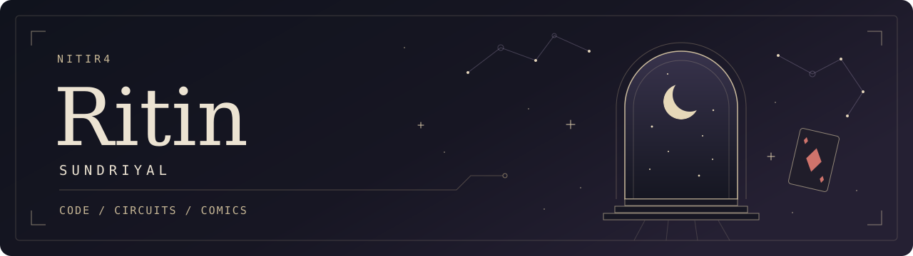

  

I'm Ritin. I write software, mess with ESP32s, and take my Linux desktop a little too seriously.

Most of what's here is Python, C or C++: desktop apps, hardware projects, and the occasional physics experiment.

### A few things I've built

| Project | What's in it |
| :--- | :--- |
| [**Bugari**](https://github.com/Nitir4/Bugari) | A native Linux Git client, written in C with GTK4. Repos, branches, history and scheduled commits. |
| [**Yog-Sothoth**](https://github.com/Nitir4/Yog-Sothoth) | Account switching and local conversation history for coding CLIs. The name should tell you something about my taste. |
| [**Geometric Drawer**](https://github.com/Nitir4/geometric_drawer) | A 2D CAD app. Draw with the mouse, enter precise measurements, or script the geometry. |
| [**ESP32 Air Drums**](https://github.com/Nitir4/ESP32-Air-Drums) | Wireless drums built with ESP32s and motion sensors. Made with friends because we were bored. |
| [**Physics & weather**](https://github.com/Nitir4/Variational-PINNs-for-Sparse-Meteorological-Field-Reconstruction-) | An experiment asking when imperfect physics helps reconstruct weather fields from sparse observations. |

### Away from the keyboard

I'm a huge nerd for comics, anime and movie series. I have a folder of **Sandman** wallpapers, a thing for **cosmic horror**, and an entire **Balatro** desktop theme. I don't really do casual interests.

---

I still think vibe coding is Stack Overflow with a new interface.
