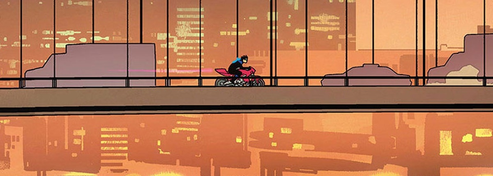

  

Nightwing #87 · Tom Taylor, Bruno Redondo &amp; Adriano Lucas · [DC preview](https://www.dc.com/blog/2021/11/18/nightwing-87-arriving-december-21). Artwork © DC.

I write software, mess with ESP32s, and take my Linux desktop a little too seriously.

Most of what's here is Python, C or C++: desktop apps, hardware projects, and occasional research experiments.

### A few things I've built

| Project | What's in it |
| :--- | :--- |
| [**BioSonic**](https://github.com/Nitir4/BioSonic3) | Species detection from audio, with a dashboard for activity across recording zones. |
| [**Septoctor**](https://github.com/Nitir4/Septoctor) | A neonatal sepsis research project, working with clinical features and risk prediction. |
| [**Linear Algebra Matlab**](https://github.com/Nitir4/Linear-Algebra-Matlab) | My second-semester projects: image compression, noise filtering and face recognition using PCA and SVD. |
| [**Profligator**](https://github.com/Nitir4/Profligator) | Coding activity from multiple platforms in one profile, with duplicate problems counted once. |
| [**Yog-Sothoth**](https://github.com/Nitir4/Yog-Sothoth) | Account switching and local conversation history for coding CLIs. The name should tell you something about my taste. |
| [**ESP32 Air Drums**](https://github.com/Nitir4/ESP32-Air-Drums) | Wireless drums built with ESP32s and motion sensors. Made with friends because we were bored. |

### Away from the keyboard

I'm a huge nerd for comics, anime and movie series. **Nightwing**, **The Sandman**, cosmic horror, and an entire **Balatro** desktop theme should give you a rough idea. I don't really do casual interests.

---

I still think vibe coding is Stack Overflow with a new interface.
